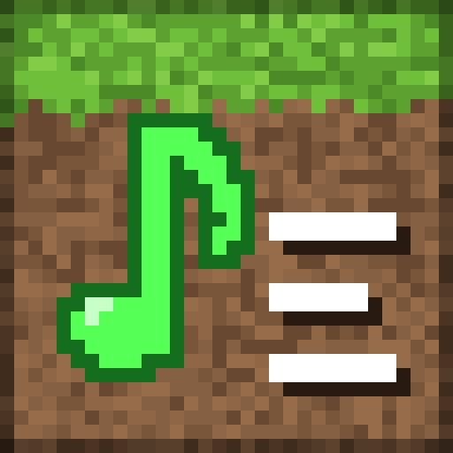
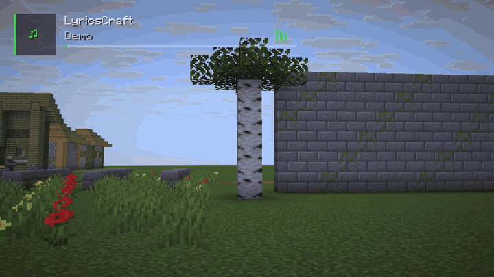

<div align="center">



# LyricsCraft

**by [iALTURKi](https://github.com/iAlturki)**

🎵 Synced song lyrics inside Minecraft. Whatever you play on your PC shows up as a now-playing card, and its lyrics follow the song: on the HUD, floating in the world, or landing word by word on the blocks around you. Arabic songs read right to left with joined letters.

[](https://github.com/iAlturki/LyricsCraft/releases/latest)




</div>

## Features

- **Synced lyrics for the version you are playing.** Lyrics are looked up on [LRCLIB](https://lrclib.net) and YouTube Music, and the version whose length matches your song wins, so a music video with a longer intro does not run early or late.
- **Word by word.** When the lyrics have word timings, the current line fills in your lyric color as it is sung.
- **Lyrics in the world.** *Floating*: each line hangs ahead of you with real depth, and steps closer or rises when a hill, tree or wall is in the way. *On Blocks*: the words of each line land one after another on the walls and ground in front of you, painted onto faces or standing on top of blocks.
- **Arabic, Persian, Urdu and Hebrew.** Right to left, with joined Arabic letters, on the HUD and in 3D. Arabic titles find lyrics listed in Latin letters too ("تملي معاك" and "Tamally Maak"), and Arabic-script lyrics win over transliterated ones.
- **Now-playing card** with cover art, progress and an equalizer, plus a toast when the song changes.
- **Media keys in game:** play, pause, next, previous, and nudging the lyrics earlier or later.
- **Fast.** Lyrics are cached after the first play, and lookups run in parallel.

## Installation

1. Install [Fabric](https://fabricmc.net/use/installer/) for **Minecraft 26.3** (a Fabric modpack such as Fabulously Optimized works too) and [Fabric API](https://modrinth.com/mod/fabric-api).
2. Download `lyricscraft-…jar` from [Releases](../../releases) and put it in your `mods` folder.
3. Play music on your PC and start the game.

Songs are picked up from anything that shows in the Windows media controls: Spotify, YouTube Music in the browser or a desktop app such as [ytr-music](https://github.com/iAlturki/ytr-music), Apple Music, TIDAL, SoundCloud and others.

> [!TIP]
> **Optional, for the best compatibility:** play your music in [ytr-music](https://github.com/iAlturki/ytr-music), an ad-free YouTube Music app for Windows. It reports the exact song, artist, length and playback position, and since LyricsCraft also finds lyrics on YouTube Music, the songs you play there match best. Any other player works too.

## Controls

| Key | Action |
|:-:|---|
| <kbd>↑</kbd> | Show or hide the lyrics |
| <kbd>↓</kbd> | Settings |
| <kbd>←</kbd> / <kbd>→</kbd> | Previous / next track |
| <kbd>\\</kbd> | Play / pause |
| <kbd>[</kbd> / <kbd>]</kbd> | Delay / advance the lyrics by 5 seconds |

All keys can be changed in Minecraft's Controls.

## Settings

| Tab | What you can change |
|---|---|
| Display | HUD style (Borderless, Bordered, Compact), player card, lyrics, position, song toast |
| Appearance | Accent color, size, opacity, hiding the HUD while paused |
| Lyrics | Number of lines, sync offset, Word-by-Word, bold, italic, uppercase, lyric color |
| 3D & Flight | 3D lyrics, Floating or On Blocks, distance, height, two-sided, glow, Elytra flight assist |

## Where the lyrics come from

1. **LRCLIB**, asking for the version of your song's length.
2. **YouTube Music**, at the same time, for songs LRCLIB does not have or has only in Latin letters.
3. When only unsynced text exists, it is spread over the song and marked with **≈**; <kbd>[</kbd> and <kbd>]</kbd> line it up.

Upload titles are read as songs: `Hamaki - Ya Sattar (Official Lyric Video) / حماقي - يا ستّار - كلمات` from a label's channel is looked up as "Ya Sattar" by "Hamaki".

## What it does on your PC

- **Network:** sends the song title and artist to `lrclib.net`, `music.youtube.com`, `api.deezer.com` and `itunes.apple.com` to find lyrics, cover art and the song length. Nothing else leaves your PC.
- **Files:** settings in `config/lyricscraft.json` (settings from LyricsPlus are picked up on the first launch), cached lyrics in `config/lyricscraft/cache`.
- **Song detection on Windows:** a small PowerShell helper, `config/lyricscraft/media_session.ps1`, reads the system media session while the game runs.
- **Local bridge:** listens on `127.0.0.1:8974` so a browser extension or player can post the playing song.

## Building

Requires JDK 25.

```
./gradlew build
```

The mod JAR is written to `build/libs/`. Every push is built by GitHub Actions.

## Credits

Made by **[iALTURKi](https://github.com/iAlturki)**: Minecraft 26.3 support, lyrics in the world and on the blocks, word-by-word lyrics, Arabic and right-to-left support, matching by song length and the YouTube Music source. Also by iALTURKi: [ytr-music](https://github.com/iAlturki/ytr-music), the ad-free YouTube Music app for Windows.

Based on [LyricsPlus](https://www.curseforge.com/minecraft/mc-mods/lyrics) 3.0.0 by FRK, a Minecraft 1.20.1 mod under the MIT License. Lyrics come from [LRCLIB](https://lrclib.net) and YouTube Music; they belong to their rights holders.

## License

MIT © 2026 iALTURKi. See [LICENSE](LICENSE), [NOTICE](NOTICE), and [AUTHORS](AUTHORS). If you fork or redistribute, keep the copyright notice and attribution intact.
